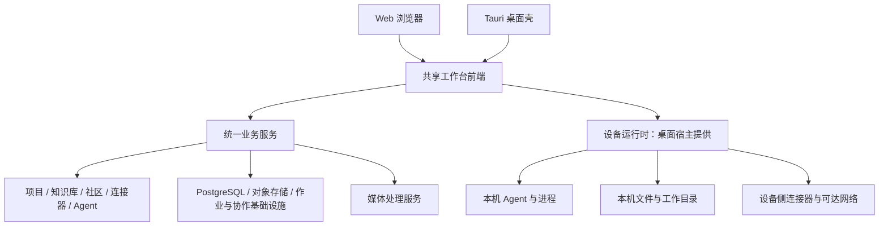

# Fouc 项目结构与代码架构设计

> 状态：设备/服务端工程边界已落地；统一访客主体、登录承接与全产品操作授权仍是待细化的目标设计。
> 适用范围：Fouc Web 与桌面双端、设备运行时、统一业务服务及共享工程。
> 本文确立项目组织与职责边界，不将目录规划、接口示意或验收目标表述为已实现功能。

## 1. 产品目标与设计约束

Fouc 是面向个人与团队的 AI 工作台，以人与 Agent 协作为核心，支持项目与需求迭代、个人与团队知识库、Agent/Skill 社区、连接器与项目任务等能力。知识库只是其中一个业务模块，不是整个产品的架构中心。

无论是否登录，用户都应能够使用产品的大部分功能。登录、资源授权、设备条件和服务权益分别限制具体操作，不能通过登录状态把整个产品或整个模块分成两套系统。

本设计遵循以下约束：

1. 一个产品、一套业务模型，Web 与桌面共享主要前端与交互逻辑。
2. 用户身份、资源归属、执行环境与服务权益相互独立。
3. 按实际业务操作授权，服务端及设备端在各自边界独立执行检查。
4. 明确数据的权威来源，不以本地与云端各存一份业务实体来模糊职责。
5. 保持模块化与最小复杂度，不提前引入微服务、通用插件内核或完整设备调度平台。
6. 项目尚未发布，重构直接形成当前唯一正确实现；不保留旧开发数据的迁移链、兼容适配器、双轨 schema 或过渡开关。开发测试数据按新的模型清理或重建。
7. 架构整理必须保持完整体验：保留用户输入、明确阻止原因、提供继续操作的路径，不以粗糙的登录拦截代替权限设计。

## 2. 架构决策

采用 **模块化单体业务服务 + 独立设备运行时 + Web/桌面共享前端 + 按操作授权**。

- 业务服务按领域模块组织，初期共享部署和数据库基础设施。
- 设备运行时作为独立进程，承担本机 Agent、文件、进程和设备执行能力。
- 桌面壳保持薄层，负责窗口、系统能力桥、更新、设备运行时的启动与看护。
- 前端消费公开业务契约与宿主能力，不直接访问数据库或依赖后端内部实现。
- API、协作和后台作业具有独立启动边界；只有实际负载与运维需求出现时才分开运行。
- 已有 Python 媒体处理 Worker 保持独立计算边界，不承担账户、业务状态或独立业务队列；独立依据见 6.2。



Web 和桌面都能调用统一业务服务。普通 Web 用户不需要安装设备运行时。Web 直接访问用户电脑上的本机能力不能作为默认能力；需要此类能力时，应通过明确的设备连接设计提供，而不是在生产环境回退访问固定的 localhost 端口。

### 2.1 资源各自授权，全产品不设工作空间

全产品没有额外工作空间实体、workspaceId 或虚构默认空间。项目是统一工作台业务隔离域，唯一菜单侧栏顶部切换当前真实项目，底部保留全局用户身份入口。任务、资产、成员、聊天和最近对话以当前项目为默认范围。连接器目录和社区资源面向全产品；设备连接仍受设备令牌、连接 ID、会话归属、原生数据库权限和明确操作许可约束。全局可发现不等于共享凭据，也不等于任意用户可以访问私有数据。

知识库以 `knowledgeBaseId` 定位真实资源，成员、分组、邀请、文件夹可见性、页面 ACL、分享链接与令牌共同决定具体操作权限。服务端在事务中设置身份及知识库范围，并使用强制 RLS、组合外键与页面权限校验保护读取、写入、检索、引用、协作、资产与异步任务。身份失效与资源权限撤销会关闭相关订阅；浏览器缓存按账户及实际资源区分，缓存不是授权依据。

项目以独立 `projectId` 定位，`project_member` 决定访问和管理权限。多项目隔离业务内容；社区与连接器目录跨项目可见，具体设备能力仍单独授权。知识库独立归属，通过 owner 配置的开放项目集合限制目录可见性，不被项目包含。

### 2.2 项目与知识库是独立、多实例资源

```text
项目 A → 项目内部工作对象
项目 B → 项目内部工作对象
知识库 A → 文件夹 → 文档
知识库 B → 文件夹 → 文档
```

知识库以 knowledge_base_project 关联声明开放项目；只有当前项目真实成员且属于该库的主体才能在当前项目目录发现它。owner 才能配置开放项目，且只能选择本人可访问的真实项目。页面 ACL、库成员关系和其它操作权限继续逐项校验；关联或引用均不改变文档归属，也不授予目标权限。跨模块操作分别校验真实目标资源与当前主体，不依赖一个虚构的共同空间。

### 2.3 前端状态归属与当前实施边界

shell 始终组合一套主导航、系统栏与当前工作面；features/project 拥有顶部项目切换和当前项目范围，features/home/chat 拥有按身份、来源和项目隔离的会话预览。工作台入口迁移既有 Dashboard 首页；features/tasks 管理真实服务端项目的多看板、Kanban、日历排期、分组表格、任务与成员授权，成员和资产主页面仍为空状态；聊天呈现当前项目历史，Agents 复用真实设备管理。旧项目目录、内置项目导航、其它旧工作台分区与自动化模块清理删除。任务用例由业务服务 modules/tasks 持有，公开契约经 @fouc/shared/tasks 导出，接口位于 /api/projects/:projectId/task-boards 和 /api/projects/:projectId/task-members；五张任务资源表使用项目组合外键和看板 ACL 强制 RLS。知识库目录使用 /api/knowledge-bases?projectId=…，开放项目配置使用 /api/knowledge-bases/:knowledgeBaseId/projects，项目 CRUD 使用 /api/projects；知识库文件夹、页面与协作继续保持原资源授权。

本机 UI 恢复记录通过 `lib/project-ui-session` 存入 WebView／浏览器 IndexedDB，以完整项目范围为键。shell 拥有页签、顺序和激活页；页面功能通过明确命名的状态项保存草稿、筛选与浏览位置，聊天预览由 features/home/chat 维护。恢复记录不授予资源访问权限，不保存第二份知识库正文，不转换为真实设备 Agent 会话；File／Date 使用结构化克隆保存，关闭页签只清理其界面状态，刷新及项目返回复用相应记录。

全局煤球小精灵归 `features/companion`，由应用根布局唯一挂载；页面切换、设置弹窗和全屏宿主切换保留同一实例与当前心情、饱腹和动作状态。无边框、无承托底色的小尺寸煤球是唯一触发器，单击只开合其上方 48px 宽的竖向图标条；工具栏与角色共用水平中心轴，减少面部随鼠标偏移的幅度。工具条以约 380ms 从下向上揭开，图标逐项浮现，收起与按压保留反馈；系统减弱动态效果时直接显示。触屏图标条适配为 52px 宽及 44px 点击区。对话为独立于角色缩放层的 14px 气泡，跟随拖拽并自动避让视口边界。整体可拖动，外层位移与角色动画分离。任意前端模块可通过 `openCompanion()` 唤醒；状态属于当前应用会话，不绑定账户、项目或知识库。

精灵工具条提供喂糖、抚摸、表情、动作与睡眠。表情菜单包含眨眼、眨单眼、开心、打瞌睡、好奇、惊讶、害羞、眩晕和睡觉；左右看保留为自动眼神行为，不占菜单。眼白和瞳孔整体放大，常态分别为 46px／18px，睁大眼睛时为 52px／14px，瞳孔保持居中并跟随鼠标。打瞌睡以缓慢合眼和点头表达，开心／眨单眼的弧线加宽加粗。主动睡觉保持闭眼与分层浮动的 Z 字，移动鼠标不会唤醒，点击角色或选择其他表情可唤醒；自动休眠仍能由鼠标移动唤醒。眩晕时三颗金色星星沿椭圆轨迹绕头旋转，状态结束自动隐藏，减弱动态效果时以静态金星表达。连续四次点击才触发炸毛，每次点击间隔不超过 1.5 秒；单击不触发炸毛，唤醒和手动菜单动作清除未完成的连击，动作繁忙时最多排队一次炸毛。跳跃和主动炸毛保留在动作菜单中。

毛发保留原始分布与 4,200 根毛丝，静态几何预计算；Canvas 按实际显示尺寸与设备像素比绘制，并为放大预留余量，毛发刷新上限 30fps。眼神跟随独立于毛发刷新，使用随帧间隔校正的插值，不叠加 CSS transform 过渡；位置只在拖拽、开合或视口变化后重新测量。减弱动态效果时毛发保持静态，显式动作仍可更新形态。后台页暂停逐帧绘制，卸载清理动画、监听、位置观察器和计时器。

顶部项目选择器明确标识本机与团队来源；当前项目中的知识库目录及创建来源与项目一致。登录会增加经授权的服务端目录，不能替换本机内容；退出或换账户立即卸载原主体私有内容，各主体独立记忆当前项目；失效选择只回落到该主体真实可见的项目，不能复制私有内容或伪造本机副本。创建时明确选择来源。知识库切换取消旧请求、关闭订阅、重置库内选择，迟到响应不能覆盖新资源；用户输入与个人偏好按账户和知识库保存。

知识库下的文件夹（内部 Teamspace）和页面明确绑定 `knowledgeBaseId`。同一事务创建知识库、创建者成员与初始文件夹。数据库业务 schema 为 `resources`，知识库及相关表保留真实归属外键和强制 RLS；项目有独立成员关系。没有空间实体、旧开发数据兼容层或固定全局范围。

开发示例为 12 个独立知识库、145 份文档，覆盖空库、不同容量、格式、来源及索引状态；仅授予内置 `admin@fouc.local`。它们是交互示例页面，不能等同于真实原文件或外部同步结果。本机资源起初为空。`backend/server/scripts/seed-development-workbench.ts --reset` 重建本机开发库的 `resources` schema 与示例，保留账户和会话；拒绝生产或非本机开发库，生产启动和构建不写示例。

| 能力 | 已实现的资源边界 | 尚未实现的产品能力 |
| --- | --- | --- |
| 项目 | 真实本机／服务端目录与 CRUD，服务端项目成员及强制 RLS；单一工作台的顶部项目切换，身份／来源／项目隔离；Dashboard 首页保留本机交互样例 | 成员、资产主页面当前为空状态；首页样例不等于服务端任务、资产或团队成员能力 |
| 任务看板 | 服务端项目隔离的多看板、默认私有／项目可见／受邀成员、只读与编辑授权；默认零视图、用户创建和命名多个看板／日历／表格视图；完整 Kanban、日／周／月日历排期、按状态分组表格、可拖动缩放的分栏任务详情、八色标签、任务清单、负责人、日期、含图片和表情的评论、搜索筛选与持久化排序 | 未接入任务级附件、AI 拆解、外部通知与 Agent 执行；本机项目不生成任务副本 |
| 知识库 | 独立目录、文件夹与文档；库成员、组、邀请、页面 ACL、编辑、协作与分享；owner 配置开放项目，目录以项目成员与库成员交集过滤 | 跨宿主访客能力仍需逐项收敛，项目关联不授予页面权限 |
| 连接器与本机 Agent | 全局目录；设备连接、会话、授权和执行能力 | 团队实例分享与跨设备执行；设备凭据不等同于公开资源 |
| 社区 | 全局资源目录演示 | 发布、安装与资源实例化的权威流程 |

新增模块先明确资源所有者、操作权限和执行宿主，再确定缓存及接口范围，不能从页面可见推断持久化或授权已经实现。

当前工作台首页按用户指定的视频 Dashboard 保留布局及可达交互；参考人物、任务和统计仅用于本机界面，按身份、项目来源和 projectId 独立保存，不写入服务端业务资源表，也不授予真实资源权限。首页以外的旧交付工作面与不存在的业务实现不作为当前产品能力；当前导航与作用域规则统一见[项目工作台设计](../projects/fouc-project-space-product-ux-design.md)。

项目引用知识内容仍逐项检查项目开放范围、知识库成员与页面 ACL；引用不授予读取权限。设备运行与连接保持真实 sessionId、connectionId 和设备能力边界，本次导航改造不创造新的 Agent 执行或发布权限。

## 3. 四个独立维度

| 维度 | 回答的问题 | 示例 |
|---|---|---|
| 身份 | 谁在操作？ | 无会话的公开访问者、受限访客会话、已登录用户 |
| 资源归属与授权 | 可以对什么做什么？ | 访客资源、个人知识库、团队项目、公开社区内容、资源 ACL |
| 执行环境 | 在哪里完成操作？ | 浏览器、当前设备、服务器执行环境 |
| 服务权益与额度 | 可以消耗哪些平台资源？ | 平台模型、存储、服务器执行额度 |

四个维度分别提供事实与决策，不能互相冒充：

- 未登录的桌面用户可以执行被允许的本机 Agent 任务。
- 未登录的 Web 用户可以使用开放给访客的服务端能力，并非只能使用浏览器存储。
- 已登录用户不一定拥有某个团队项目的访问或修改权限。
- 用户具有项目修改权限，不代表浏览器具备本机终端执行能力。
- 登录不改变已选择任务的执行位置。
- 连接外部服务可能需要该服务的授权，但不等于所有连接器操作都必须登录 Fouc。
- 设备通信令牌不是账户身份，更不能用于授予团队资源权限。

具体访客能力、额度和内容保留期限由产品规则定义。本文不凭架构推导固定的免费额度、默认期限或“所有 AI 功能必须登录”等规则。

## 4. 统一身份与操作授权

### 4.1 同一模块入口

每个业务模块使用一套主要页面和用例入口。禁止普遍采用“未登录进入访客版模块，登录进入账户版模块”的整模块分流。

推荐流程：

```text
进入同一个模块
  → 确定当前资源范围
  → 加载可访问资源与可用执行环境
  → 判断具体操作是否允许
  → 执行操作，或展示对应的继续路径
```

权限与能力信息用于页面呈现。每次实际执行仍必须在权威边界重新检查，不能信任前端按钮的可用状态，也不能将缓存的许可当作长期有效的授权凭据。

### 4.2 稳定的操作标识

围绕业务操作定义许可，例如：

- `project.read`、`project.update`、`project.member.invite`。
- `knowledge.document.read`、`knowledge.document.edit`。
- `community.read`、`community.publish`。
- `connector.authorize`、`connector.execute`。
- `run.start`、`run.cancel`。

这些名称是设计示例，不表示当前已有统一授权 API。操作标识需要有明确资源和上下文，不能只返回脱离资源的全局 `canEdit`。

模块拥有自己的业务授权规则；平台提供统一的身份上下文、决策结果格式与通用检查基础设施。避免把所有领域规则堆进一个不断扩大的全局权限函数。

### 4.3 阻止原因与交互闭环

| 原因 | 用户反馈与继续路径 |
|---|---|
| 需要登录 | 解释当前操作需要账户，登录后回到原操作 |
| 资源权限不足 | 说明所需权限，按产品能力提供申请入口 |
| 执行环境不可用 | 选择可用执行器，或连接需要的设备 |
| 缺少外部服务授权 | 打开对应服务的授权流程 |
| 平台额度不足 | 展示额度状态与实际可用的替代能力 |
| 服务暂不可用 | 保留输入与工作状态，提供重试 |

检查顺序与错误暴露必须兼顾资源保密：不能向无权用户泄露私人资源存在性。服务不可用不等于未登录；资源授权失败也不应清除有效账户会话。

登录续接只保留允许恢复的操作意图和必要输入，不保留或跳过旧授权结论。恢复时重新校验资源与条件；可重复提交的命令采用幂等机制。对需要用户最终确认的操作，登录完成后恢复确认步骤，不自动提交。

### 4.4 设备侧许可

业务服务负责账户与共享资源授权，设备运行时负责文件、命令、进程等设备操作的许可。需要两侧条件的操作必须同时满足两侧条件。

用户登录不能替代设备操作许可，服务器下发任务也不能绕过设备端的执行边界。设备运行时不能通过前端提供的用户 UUID 自行推定云端资源权限。

### 4.5 安全与证据边界

- Agent、连接器和远程环境凭据不进入模型上下文；仅传入当前任务需要的最小脱敏资料。Fouc 不复制 Agent 原生长期凭据。
- 本机执行与远程服务是独立信任域。Agent 的自然语言结论不能越过确定性权限、审批或验收状态机。
- 高风险操作需要可撤销的明确授权；记录请求人、执行主体、资源范围、实际动作和可复核证据。重要制品以版本或摘要固定。
- 不保存模型隐藏思维链作为产品证据；展示计划、结论、来源、操作及产物即可。

## 5. 访客资源与登录承接

### 5.1 访客不等于离线模式

公开读取可以无会话。需要服务端保存私有工作状态的访客用例，可由服务端签发受限访客会话，为其提供隔离的工作范围。

访客会话是明确的受限主体，不是隐藏注册账户：没有虚构邮箱、用户账户记录或团队成员资格。凭据由服务端签发和验证，不依赖客户端随意声明的访客 ID 证明所有权。

访客拥有私有状态时，身份边界需要明确会话有效期、资源保留规则、访问隔离、退出与清理行为，以及平台资源消耗限制。会话过期或浏览器凭据丢失后的恢复能力应当在产品中说明，不把临时资源宣称为永久可靠存储。

### 5.2 浏览器与设备存储的定位

浏览器存储用于缓存、未提交输入以及用户明确选择的本机资源。当前本机项目的交付目标、设置和事件在 IndexedDB 中按 projectId 原子持久化，复用共享领域契约；它是明确的本机资源来源，不是未登录、登录失败或服务故障时生成的团队项目副本。账户身份变化不自动迁移或替换这些内容，浏览器存储被清理后的保留与恢复能力应如实说明。

设备存储用于设备偏好、安装信息、执行日志、必要缓存和运行恢复状态。只有具有真实设备职责的数据才留在设备运行时；不建立另一套团队项目、共享知识库或社区数据库。

本机能力由实际用例与宿主条件决定，不以未登录推导一套不同业务模型，也不作为登录失败时悄然切换的数据来源。团队项目的成员授权、邀请与远程发布继续由服务端拥有，本机 owner 不等于服务端成员资格。

### 5.3 登录后的承接规则

登录不能直接替换整个模块，也不能造成当前工作内容消失。

对于需要承接的访客资源，服务端应验证当前账户与访客会话，通过明确的归属变更用例完成承接。归属变更必须原子化、可重复请求而不重复创建资源，并使旧访客凭据按规则失去访问已承接资源的能力。

将访客资源归于账户，与把内容合并进已有项目或知识库，是不同操作。后者需要明确目标及其操作权限，不能自动混入团队数据。设备上的文件和私有凭据也不能因登录而隐式上传。

具体承接范围与保留规则属于待细化的产品设计，不在本次文档中假定为已实现。

## 6. 服务端与设备运行时职责

| 事项 | 统一业务服务 | 设备运行时 |
|---|---|---|
| 身份与资源授权 | 账户、访客会话、组织、团队和资源权限 | 设备访问与设备操作许可 |
| 项目与工作对象 | 项目、需求、迭代、任务定义和协作状态 | 执行任务所需的本机上下文 |
| Agent/Skill | 定义、目录、版本、发布、共享与策略 | 发现安装、实际调用和设备生命周期 |
| 连接器 | 共享配置、授权关系、外部资源引用 | 设备侧凭据与只能从设备访问的能力 |
| 执行 | 授权、任务状态、执行目标及结果引用 | 本机 Agent、进程、工作目录和运行恢复 |
| 数据 | 共享业务实体及平台拥有的内容 | 设备事实、执行记录与必要缓存 |

同一领域可以在两侧存在职责不同的模块。例如，服务端的连接器模块维护共享定义与授权范围，设备侧适配器执行当前设备可达的操作。两侧共享契约，不共享数据库或内部仓储实现。

凭据按执行位置与授权归属保存：平台凭据在服务端管理；本机凭据在设备侧管理。前端只消费必要的公开状态和引用，不成为密钥持久化中心。

对象存储的签名、上传、读取与删除由 `platform/storage/s3` 提供中立基础设施。知识库资产与任务评论图片分别在所属业务模块决定对象键、元数据和授权，互不导入内部实现；基础设施不决定资源访问权限。

### 6.1 执行目标与任务状态

工作任务与执行实例应区分。一个任务可以经历多次运行；每次运行关联明确的执行目标、执行器、输入范围和状态。

服务端记录平台任务与运行状态，设备运行时记录设备侧实际进程状态。二者通过运行标识、事件序号和公开协议对齐，不共享可写的底层存储。

运行状态不能将“已下发”当成“已执行”，不能将断开连接当成成功。取消、超时、失败与结果提交应有明确语义；重试不能意外重复执行同一具有外部副作用的命令。

当前阶段只实现已有执行场景需要的目标与协议。远程设备注册、任务中继和复杂调度在真实需求出现后再扩展。

### 6.2 媒体处理为何独立运行

现有 `services/media-worker/` 是无状态 Python/FastAPI 内容处理服务，使用 `faster-whisper` 转写音视频、使用 Docling 解析 PDF 与 Office 文档。它不是普通文件上传服务，也不是第二套业务后端。

保留独立运行边界的依据：

- **运行依赖不同**：Python、模型及文档解析依赖不应进入 Bun 业务进程或桌面 sidecar 的分发依赖。
- **资源与故障隔离**：解析和推理任务可能耗时且资源消耗较重，应独立控制并发、超时、子进程终止与临时文件清理；不因此阻塞普通业务请求。
- **部署条件不同**：按实际处理需求配置 CPU/GPU 与模型缓存，不要求 API 节点或每个桌面客户端安装完整处理环境。

调用边界保持如下职责：

```text
业务服务：授权 → 管理任务与重试 → 提供受限文件访问 → 调用 Worker → 保存结果
媒体 Worker：获取授权输入 → 解析或转写 → 返回派生结果 → 清理临时资源
```

现有 Worker 不拥有账户、资源 ACL、业务数据库或独立任务队列，其处理结果由业务服务管理。它通过短期签名资源地址读取输入，不持有对象存储长期凭据。服务应保持内部调用与独立认证，前端不直接获得其调用密钥。

独立进程有明确价值，但 HTTP 服务不是唯一可行方案。TypeScript 调用 Python 子进程也能实现基本功能，只是主服务需要承担 Python 环境和处理进程管理。当前已有受限 HTTP 契约与处理隔离实现，合并会增加主服务耦合且缺少明确收益，因此本阶段保留现有边界，不再额外拆出转写、PDF、Office 等多个服务。

文件上传与内容解析是不同操作。只需要保存原文件的流程，以及项目管理、社区浏览等无关功能，不应以媒体 Worker 就绪作为全局可用性前提。处理服务不可用时，依赖它的用例提供失败、等待或重试状态，不能假报解析完成。

媒体处理是可被业务模块调用的基础设施能力，相关用例仍留在所属业务模块。当前调用方位于知识库中；出现其他实际调用方时再抽取服务端共享适配器，不让其他模块依赖知识库内部实现，也不预建空的全产品媒体模块。

## 7. 数据归属与权威来源

| 数据类别 | 权威来源 |
|---|---|
| 账户、组织、团队成员、资源权限 | 统一业务服务 |
| Fouc 自身拥有的项目与协作状态 | 对应服务端业务模块 |
| Fouc 自身拥有的知识内容与社区发布内容 | 对应服务端业务模块 |
| 外部代码仓、工单、文档、流水线与运行事实 | 对应外部系统；Fouc 保存必要引用、关系与快照 |
| 本机 Agent 安装、进程、文件与设备运行记录 | 当前设备及设备运行时 |
| 浏览器缓存、未提交输入 | 当前客户端，不冒充服务端保存结果 |

执行环境与数据权威来源相互独立。本机执行可以使用经过授权的共享上下文；服务器执行也可以引用外部系统内容。

索引、缓存、预览和统计是派生数据，不成为第二套可独立修改的业务事实。更新与删除需要明确派生数据失效和重建路径。

## 8. 目标工程结构

保留单仓库、根目录前端工程及有效的现有目录，使用 pnpm workspace 分开后端运行、构建和依赖边界。根目录继续承载共享前端，`backend/` 承载两套独立后端包，`shared/` 继续承载公开契约。两套后端包已拆分；以下业务模块树是扩展参考，未实现的模块不创建空目录。实际启动命令见仓库 [README](../../../../../README.md)。

```text
src/                             Web 与桌面共享的 Next.js/React 前端
├─ app/                          路由及页面装配
├─ shell/                        工作台导航、布局与全局交互
├─ lib/                          传输、宿主能力与客户端基础设施
├─ components/                   通用 UI 与跨模块工作台组件
└─ features/                     沿用现有有效命名，按功能新增模块
   ├─ project/
   ├─ knowledge/
   ├─ community/
   ├─ connectors/
   ├─ identity/
   ├─ session/

src-tauri/                       Tauri 薄壳、打包、更新及进程看护

backend/
├─ device/                       独立设备运行时包
│  ├─ package.json
│  ├─ tsconfig.json
│  └─ src/
│     ├─ entrypoints/
│     ├─ agents/
│     ├─ execution/
│     ├─ connectors/
│     ├─ permissions/
│     ├─ platform/
│     └─ storage/
└─ server/                       独立统一业务服务包
   ├─ package.json
   ├─ tsconfig.json
   └─ src/
      ├─ entrypoints/            API、协作、作业的启动与装配
      ├─ platform/               身份、授权基础设施、数据库、作业
      └─ modules/                依据已实现的领域逐步组织
         ├─ projects/
         ├─ knowledge/
         ├─ community/
         ├─ connectors/
         ├─ agents/

shared/                          公开 API、事件、设备通信及运行契约
services/
└─ media-worker/                 Python 内容处理 Worker

public/
docs/
scripts/                         仓库级开发与工程脚本
package.json                     根目录前端与仓库级命令
pnpm-workspace.yaml              注册 shared 与两套后端包
```

Web 与桌面共享前端源码，分别由宿主适配和构建配置处理差异。Web 服务与桌面静态产物的构建目标需独立验证，不把仅 Web 可用的服务端路由当作桌面运行的隐含依赖。

`src/lib/` 中的职责可按实际需要建立子目录，没有必要统一改名为 `platform/`。现有 UI 组件保留在 `src/components/`，模块私有组件保留在对应 feature 内。Web 与桌面使用同一前端源码，本身不构成拆出 `packages/ui` 的理由。树中的模块目录按实际业务建立，不提前创建空模块。

消息提示统一由 `src/components/app-alert.tsx` 的同一深色材质与四种语义承接。根布局中的 `AppAlertProvider` 提供唯一全局宿主，业务操作通过 `useAppAlert` 发布底部居中 Toast，不在模块内维护通知 DOM 或关闭计时器。连续通知替换内容并重新计时，关闭与异步清理按消息 ID 隔离，导航不会丢失尚未结束的反馈；悬停与键盘聚焦暂停自动关闭。宿主进入当前原生 `dialog` 并使用浏览器顶层 Popover，保证模态窗口中的通知可见且可操作，窗口关闭后返回页面。需要持续解释认证、权限或操作失败的上下文消息直接复用 `AppAlert` 并保留恢复操作；字段校验、内容加载状态及危险操作确认保留各自交互职责。

共享交互状态归 `src/components/ui/interaction-states.css`，主题令牌归 `src/app/globals.css`。`Button`、`DropdownMenuTrigger` 与知识库 `IconButton` 统一应用 `fouc-action`：浅色主题中性操作的悬停、键盘焦点、按下及菜单展开使用同一 `#fafafa` 中性浅灰底，底色即时出现而不通过背景渐变延迟反馈；`data-active="true"` 的筛选入口在这些状态下保留黑白灰强调文字与图标，避免中性操作色覆盖激活态；危险与警示操作沿用各自语义色。目录折叠箭头使用 `data-variant="disclosure"`，反馈由整行承担，箭头在展开、悬停与键盘焦点时均保持透明底色。菜单展开以 `aria-expanded` 判断，避免 Tooltip 覆盖 `data-state` 后入口丢失反馈。侧栏材质与导航行样式统一从根 `globals.css` 加载，主导航、项目管理与设置使用 `--wt-sidebar-standard-panel` 的 `#f9f9f9` 中性浅灰底座（与菜单参考图的平坦背景精确一致），知识库目录与社区分类使用 `--wt-sidebar-content-panel` 的白色面板，社区通过 `sidebar-material` 的 `data-surface="content"` 选择该材质；深色模式使用 `#141414` 侧栏与中性灰面板。局部 CSS 只引用共享状态令牌并处理布局及业务特有呈现。主导航、设置及共用导航行选中项使用 `#efefef` 浅灰底条，hover 与键盘定位使用更浅的 `#fafafa`；保留 `#e3e3e3` 细描边，不叠加浮起阴影。普通鼠标焦点不代表激活，分区标题只在悬停时显示底条，离开即清除；标题的键盘定位仅显示边框；Fouc 通用中性图标默认采用半实心双色风格：深灰轮廓与同色 20% 不透明度的浅灰局部填充，优先复用 Phosphor duotone，保留镂空与结构细节，不对 SVG 整体添加填充。侧栏图标通过 --sidebar-icon 在深浅主题适配；主导航、项目导航、设置分区与工作台分组共享同一灰度，选中时图标的造型、填充与颜色保持不变，由行背景、描边和文字表达当前项。明确指定的彩色功能图标、品牌／用户内容图标及专用场景沿用各自规范；箭头、加号、关闭等操作符保持线性。不使用彩色光晕、弹跳或标签位移。白色知识库目录的 hover 使用中性浅灰反馈，选中项使用共享浅灰底与细描边，均即时显示反馈，不对底色或阴影做渐变。视觉验证同时检查实际底色与菜单项反馈，保证状态清晰可辨。知识库文档工具栏是模块私有组合组件，复用共享按钮和 Radix 菜单，不另建弹层与交互状态实现。列表/卡片切换由共享 `ViewSwitcher` 统一呈现（列表在左、卡片在右，hover 保留图标原色），资源卡片由共享 `resource-card.module.css` 统一描边；筛选/排序入口回焦不产生 ring、阴影或边框渐变。

工作台主导航底栏左侧组合 `features/identity` 的 `AccountItem`，展开时显示头像与名称，邮箱和状态设置放在账户菜单内；右侧组合主题切换与设置按钮。收起时底栏仅显示账户头像，隐藏主题和设置。项目与知识库在各自模块切换，不提供全局工作空间入口。

应用设置由 `features/settings` 的原生模态弹窗承载，内部直接复用原设置画布，保留原有背景、字体、卡片、分区顺序、搜索和侧栏调宽，默认打开外观分区。侧栏标题不显示返回图标，右侧各分区内容上边距较原页面减少 4px；内容滚动条隐藏，保留滚轮、触控和键盘滚动。`shell` 只负责组合弹窗与工作台，打开设置时保持原工作面挂载，保留草稿、选择、滚动和项目管理面板。URL 的 `view=settings` 标记打开状态，`returnView` 记录原视图，`section` 定位分区；关闭按钮、Escape 和遮罩点击统一关闭，恢复原视图及入口焦点。模态弹窗阻止背景交互，内部菜单与提示通过共享弹层宿主进入原生顶层，避免遮挡和焦点失效。外观仅保留浅色 / 深色 / 跟随系统与字体、字号偏好，即时生效并持久化。全产品通用操作与选中态固定使用黑白灰，已验收且承担任务或模式识别的局部功能配色保留；`--accent*` 只作为固定中性强调角色使用，实色操作面上的文字使用 `--accent-foreground`，随深浅模式反转以保证对比度。彩色主题预设、自定义取色、偏好字段、首帧属性注入及切换监听全部移除。危险、警示、成功等语义色，以及第三方品牌、内容色与数据可视化配色按其实际含义保留，不承担产品主题色角色。

黑白灰约束针对工作台框架、通用导航、菜单反馈、基础按钮、筛选与行列选中，不覆盖已验收的局部功能配色。AI 输入区快捷功能与引用标签的专属配色、添加菜单的青／粉／紫／绿模式图标、思考强度的紫色当前档位按对话设计保留；社区官方认证为蓝色、评分与收藏为金色，资源头像、字标、类型徽标和项目资源身份图标使用各自识别色。SQL 工具保留运行绿、执行计划紫、格式化橙、文件蓝、结果面板青和快捷加工青绿，并通过稳定的功能属性标识类别，切换语言不改变配色；条件与排序分别保留蓝／橙，字段类型、键标记、语法与图表保留数据含义。知识库任务勾选、完成计数、格式工具、正文与评论链接、引用标记和 AI 内容块保留原有蓝／紫功能色；协作者、用户设置的图标／标签／单元格／高亮与第三方品牌保留内容语义。`--accent*` 始终只承担中性操作强调；`--info*` 固定承载原有蓝色信息、运行进度与数据类型，不提供主题切换，也不用于通用导航或基础按钮。成功、连接、未保存、警告与失败继续使用对应状态色；复制失败明确为红色，不能被普通反馈色覆盖。实色操作面的前景随深浅模式保持可读；ER 结构与导出保持中性，主键金色、外键蓝色。

### 8.1 允许的依赖方向

```text
src/            → shared/ 的公开契约、前端组件与宿主适配
src/            → @fouc/server/knowledge-api 的公开类型契约（仅 type-only）
backend/server/ → shared/ 的公开契约、服务端模块及基础设施
backend/device/ → shared/ 的公开契约、设备模块及设备适配器
src-tauri/      → 宿主桥、设备进程看护与打包产物
```

约束：

- 前端禁止导入服务端或设备运行时的内部实现。
- 现有 tRPC 路由推导类型通过业务服务公开的 `@fouc/server/knowledge-api` 导出，包只提供 `types` 条件；前端使用 `import/export type`，运行时导入被边界检查拒绝。该类型入口避免复制路由定义，浏览器编译验证其输出不含后端运行时。
- 服务端禁止导入设备运行时内部代码，反向同样禁止。
- 设备运行时禁止直接连接共享业务数据库。
- 共享契约不依赖 React、Tauri 或具体数据库驱动；可以使用明确的契约校验库。
- 包之间通过公开导出访问，禁止深层路径绕过边界。
- 禁止循环依赖；宿主差异集中在适配层，不散布大量 `isTauri` 分支。
- 不建立无明确消费者的通用 `core`、`utils` 或业务引擎共享包。

### 8.2 结构选择的依据与取舍

保留根目录结构是工程判断，不是仅为减少文件移动：

1. 当前只有一套共享前端，根目录 `src/` 能准确表达其职责；迁入 `apps/workbench/` 不增加隔离或复用价值，却会牵动 Next.js、脚本、桌面打包及开发路径。
2. `src-tauri/` 已表达桌面薄壳职责，`shared/` 已是 workspace 包；重命名这些目录不能替代依赖检查。
3. 设备运行时与业务服务具有不同分发对象、运行依赖、配置和权限边界，必须拆成独立包。仅因沿用现有结构而继续共用一个后端包，会保留真正的混杂。
4. 多个前端应用需要独立构建、发布或消费同一 UI 包时，再评估 `apps/`、`packages/ui` 等组织形式。当前不提前引入该层级。
5. 不要求前后端内部目录命名完全相同。前端按交互功能组织，服务端按领域与用例组织；契约与职责一致比名称对称更重要。

目标是保留有效结构、重写错误边界，不追求目录形式的统一美观。后续结构调整必须由可验证的独立构建、复用或维护需求支撑。

## 9. 业务模块内部结构

复杂业务模块采用以下结构；简单模块只建立真实需要的层次。

```text
模块/
├─ api/                           请求解析、身份上下文与响应映射
├─ application/                   用例编排、授权调用、事务边界
├─ domain/                        业务规则与状态转换
└─ infrastructure/                存储及外部服务具体适配器
```

依赖由入口装配，业务规则不依赖 HTTP 框架、React、Bun 服务器对象或数据库连接。

- API 层不承担完整业务流程，也不绕过用例直接写表。
- Application 层组织操作、确定事务与外部副作用顺序。
- Domain 层只在存在值得独立表达的规则时建立，不制造空对象与空接口。
- Infrastructure 层实现具体存储、进程、模型和外部服务访问。
- 前端模块按页面、交互组件、查询与操作组织，不复制服务端授权规则。

跨模块需要立即返回结果的操作调用公开用例接口；索引、通知、解析等后续工作使用可靠作业或事件。在数据库写入与异步发布需要一致性时使用事务与 outbox 等已有可靠机制，不为每个简单交互引入事件总线。

每个模块拥有自己的表和写入规则。跨模块引用及事务通过明确的公开边界协调；不得由任意模块直接调用其他模块的内部仓储修改其数据。

## 10. 部署、运行时与开发配置

业务服务先保持模块化单体。业务模块不是必然的独立网络服务，初期不按项目、知识库、社区分别建设微服务。

API、协作与作业拥有明确运行职责；独立角色启动时只装配本角色需要的资源与监听器，不能依靠不同角色名称掩盖实际仍启动全部能力的行为。

TypeScript 后端以 Bun 为当前运行时，业务代码保持 Node 兼容 API 子集。Bun 服务器、SQLite 和其他运行时专属能力集中在适配器中，不宣称只替换命令即可运行于 Node。

桌面构建仅编译设备运行时和前端，随后由 Tauri 打包。Windows 的主要可执行程序仍是 `fouc.exe` 与 `fouc-backend.exe`；后者对应 `backend/device/`，不包含集中部署的业务服务。`backend/server/` 通过 `pnpm server:build` 独立构建和部署，前端引用其公开类型不意味着服务端运行时进入客户端。命令与产物对应关系见仓库 [README](../../../../../README.md)。

独立服务的协议不限定实现语言。即使从零开始，按当前产品目标也优先选择 TypeScript：核心复杂度在业务对象、操作契约、授权与 Agent/工具编排，双端前端与实时协作具有纯协议和 schema 的真实共享需求，计算处理则采用独立 worker 边界。已有代码重写成本不是选择依据；没有完整的工作负载和运行指标，不能宣称某语言适用于所有未来场景。语言与 Bun/Node 运行时分别评估。Python 媒体处理边界保持。若后续需要 Python/Go 独立能力，先定义语言无关契约并验证行为；现有前端公开 tRPC 类型仍有编译期耦合，不能把独立部署误解为可无成本替换语言。模块化单体仍是业务服务的当前部署方式。

生产部署：

- 业务服务集中部署，Web 与桌面使用明确配置的服务地址。
- 设备运行时随桌面应用分发，由桌面壳看护，并通过受保护的设备端接口访问。
- 服务端身份与设备通信分别认证，不能共用或混淆令牌。
- 外部服务通过标准适配器接入；共享业务不直接依赖当前开发电脑路径。

开发部署：

- Web dev 服务、设备运行时、业务服务分别启动与检查。
- 当前开发常用端口为 3000、8710、8711；这些端口不是业务契约。
- 聚合开发脚本应复用已运行的正确服务，校验工程归属与就绪状态，避免重复启动。
- 独立包具备明确的开发、类型检查、测试和构建命令。
- 环境配置区分客户端公开地址、服务端密钥与设备配置，禁止把秘密写入公开前端变量。
- 开发与验证遵循仓库 `AGENTS.md`：Web 服务常驻；仅在明确要求桌面验证或发布时构建 Tauri。

## 11. 验证要求

验证围绕真实边界和关键行为，不编写只镜像实现或验证目录存在的测试。

- 独立包类型检查、必要的契约测试与依赖方向检查通过。
- 访客、已登录用户及无资源权限用户的允许/拒绝行为符合规则。
- 前端隐藏按钮不能绕过后端授权；设备令牌不能调用账户资源接口。
- 登录、退出、会话过期、服务故障不会错误地切换业务数据来源。
- 登录续接保留输入，并重新校验权限和幂等条件。
- Web 与桌面共享流程成立；不具备设备能力的宿主提供完整替代或提示。
- 运行断连、重试、取消及恢复不误报成功，不造成非预期重复执行。
- 外部权威资源、平台业务状态与设备事实的归属明确。
- 开发服务与实际必要的构建产物可运行；未验证的平台和部署场景明确报告。

## 12. 待细化的产品规则

以下能力尚未有完整的产品规则与实现；新增功能前在对应主题设计中确定：

1. 各业务操作对访客开放的范围、额度与内容保留规则。
2. 访客登录后的承接范围、目标空间选择与冲突处理。
3. 任务、运行和执行目标的完整状态协议与副作用处理。
4. 各模块对共享数据与设备数据的逐项归属。
5. Web 是否及何时需要连接远程设备，以及对应的设备授权和通信方案。

这些事项不阻止先拆清运行包、依赖方向与模块边界，但在相关功能实施前必须形成明确规则。

## 13. 相关文档

- [产品愿景与定位](../../../vision-and-positioning.md)
- [P0 基础能力清单](../../p0-foundation-capabilities.md)
- [统一身份与授权](../identity/fouc-identity.md)
- [连接器架构](../connectors/connector-architecture.md)

本设计的长期约束是：**一个 Fouc 产品、一套业务模型；身份控制具体操作许可，宿主提供具体执行能力，业务模块维护自己的权威状态。**
